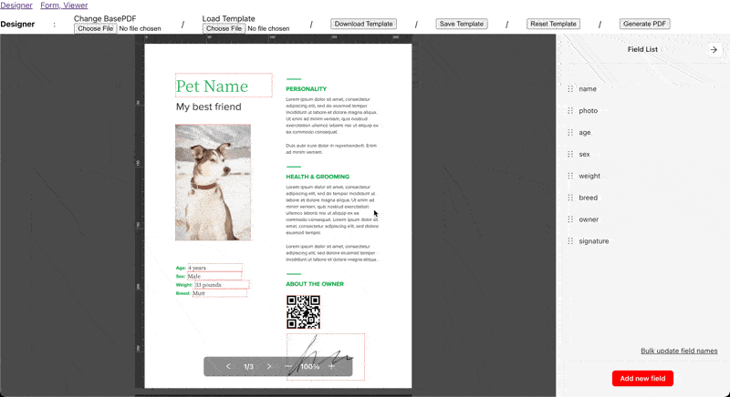

# Custom UI

`@pdfme/ui` allows customization of themes and labels through options.  
This page explains how to customize these elements.

_Sample code uses the [Designer](/docs/getting-started#designer), but [Form](/docs/getting-started#form) and [Viewer](/docs/getting-started#viewer) can be customized in the same way._

## UI Theme

pdfme internally uses [Ant Design](https://ant.design/).
You can apply the Ant Design theme to the pdfme UI.

Refer to [Ant Design's documentation](https://ant.design/docs/react/customize-theme) for how to customize the theme.  
For the API reference, see [here](https://ant.design/docs/react/customize-theme#api).

```ts
new Designer({
  domContainer,
  template,
  options: {
    theme: {
      token: {
        colorPrimary: 'red',
      },
    },
  },
});
```



## UI Language and Labels

:::note
The label customization feature is not yet implemented.
[Custom Label for UI #107](https://github.com/pdfme/pdfme/issues/107)
:::

To change the language, modify `lang` in `options`. (The default for `lang` is `en`.)
Currently, `'en', 'zh', 'zh-TW', 'ja', 'ko', 'ar', 'th', 'tr', 'pl', 'it', 'de', 'es', 'fr'` are supported.
To support additional languages, create an issue or send a pull request.

To use custom labels instead of the provided ones, change `labels` in `options`.
For supported labels, refer to [this i18n.ts](https://github.com/pdfme/pdfme/blob/main/packages/ui/src/i18n.ts).

pdfme first loads `lang` from `options`, then reads and overrides from `options`' `labels`.

```ts
new Designer({
  domContainer,
  template,
  options: {
    lang: 'ja',
    labels: {
      fieldsList: '入力項目一覧ビュー', // override the label for the edit button
      youCanCreateYourOwnLabel: '独自のラベルを作成できます', // add a new label for the custom plugin
    },
  },
});
```

Create your own labels and use the i18n function from the plugin to retrieve the labels. Please refer to the official [Signature plugin](https://github.com/pdfme/pdfme/blob/main/packages/schemas/src/graphics/signature.ts) implementation in `@pdfme/schemas`.

## UI Maximum Zoom Level

By default, pdfme can zoom up to 200% of the original PDF size. 
If you wish to increase this you can pass the `maxZoom` option, the percentage that you want to be the new limit, to the Designer, Form, or Viewer. 
This value should be greater than 100 and a multiple of 25. 

```ts
new Designer({
  domContainer,
  template,
  options: {
    maxZoom: 400,
  },
});
```

## UI Options

You can control aspects of the UI state by passing options:

```javascript
// Initialize with specific states (also works for Form and Viewer):
const designer = new Designer({
  domContainer,
  template,
  options: {
    zoomLevel: 1.5,
    sidebarOpen: false,  // (Designer only)
    leftSidebarWidth: 100,  // (Designer only) default: 45px
    rightSidebarWidth: 450,  // (Designer only) default: 400px
  }
});

// Update states after initialization:
designer.updateOptions({
  zoomLevel: 2,
  sidebarOpen: true
});
```

`leftSidebarWidth` and `rightSidebarWidth` (Designer only) set the widths of the left plugin sidebar and the right property panel sidebar in pixels. They accept positive numbers and default to 45px and 400px respectively.

Note: very small widths clip the plugin buttons and the property panel.

### Guides

`guides` (Designer only) configures the guides dragged out of the rulers. All fields are optional, and without them guides behave as before: positions are rounded to the millimeter, snap nowhere and are not labeled.

```ts
new Designer({
  domContainer,
  template,
  options: {
    lang: 'fr',
    guides: {
      precision: 1, // decimals kept for the position of a guide, 0 to 2 (default: 0)
      snapToPageCenter: true, // magnet at the middle of the page (default: false)
      showPosition: true, // show the position while dragging and on the guides (default: false)
    },
  },
});
```

- `precision`: number of decimals of the position of a guide, in mm. One pixel of the ruler is about 0.26 mm, so a higher precision alone only lets you place a guide more finely, not exactly at a given value.
- `snapToPageCenter`: guides snap to the middle of the page, computed for each page (for A4, 105 mm horizontally and 148.5 mm vertically). A page with an odd size has a half-millimeter middle: set `precision` to at least `1`, otherwise the position is rounded (149 mm instead of 148.5 mm). Elements being moved then snap to this guide as they do to any other.
- `showPosition`: shows the position in mm next to the guide being dragged and next to the guides already placed. The number is formatted with `options.lang` (`148,5 mm` with `fr`, `148.5 mm` with `en`).

Guides already placed keep their position. `updateOptions` replaces the whole `guides` object.
