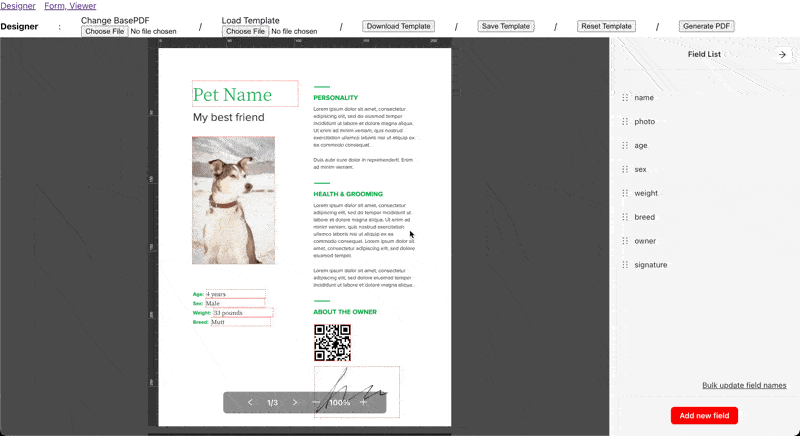

# カスタムUI

`@pdfme/ui`はオプションを通じてテーマとラベルのカスタマイズが可能です。  
このページではこれらの要素をカスタマイズする方法を説明します。

_サンプルコードは[デザイナー](/docs/getting-started#designer)を使用していますが、[フォーム](/docs/getting-started#form)と[ビューワー](/docs/getting-started#viewer)も同じ方法でカスタマイズできます。_

## UIテーマ

pdfmeは内部的に[Ant Design](https://ant.design/)を使用しています。
Ant Designのテーマをpdfme UIに適用することができます。

テーマのカスタマイズ方法については[Ant Designのドキュメント](https://ant.design/docs/react/customize-theme)を参照してください。  
APIリファレンスは[こちら](https://ant.design/docs/react/customize-theme#api)をご覧ください。

```ts
new Designer({
  domContainer,
  template,
  options: {
    theme: {
      token: {
        colorPrimary: 'red',
      },
    },
  },
});
```



## UI言語とラベル

:::note
ラベルカスタマイズ機能はまだ実装されていません。
[Custom Label for UI #107](https://github.com/pdfme/pdfme/issues/107)
:::

言語を変更するには、`options`の`lang`を変更します。（`lang`のデフォルトは`en`です。）
現在、`'en', 'zh', 'zh-TW', 'ja', 'ko', 'ar', 'th', 'tr', 'pl', 'it', 'de', 'es', 'fr'`がサポートされています。
追加の言語をサポートするには、issueを作成するかプルリクエストを送信してください。

提供されているラベルの代わりにカスタムラベルを使用するには、`options`の`labels`を変更します。
サポートされているラベルについては、[この i18n.ts](https://github.com/pdfme/pdfme/blob/main/packages/ui/src/i18n.ts)を参照してください。

pdfmeはまず`options`から`lang`を読み込み、次に`options`の`labels`から読み込んで上書きします。

```ts
new Designer({
  domContainer,
  template,
  options: {
    lang: 'ja',
    labels: {
      fieldsList: '入力項目一覧ビュー', // 編集ボタンのラベルを上書き
      youCanCreateYourOwnLabel: '独自のラベルを作成できます', // カスタムプラグイン用の新しいラベルを追加
    },
  },
});
```

独自のラベルを作成し、プラグインからi18n関数を使用してラベルを取得します。`@pdfme/schemas` の公式[署名プラグイン](https://github.com/pdfme/pdfme/blob/main/packages/schemas/src/graphics/signature.ts)の実装を参照してください。

## UI最大ズームレベル

デフォルトでは、pdfmeは元のPDFサイズの最大200%までズームできます。
これを増やしたい場合は、新しい制限にしたいパーセンテージを`maxZoom`オプションとしてデザイナー、フォーム、またはビューワーに渡すことができます。
この値は100より大きく、25の倍数である必要があります。

```ts
new Designer({
  domContainer,
  template,
  options: {
    maxZoom: 400,
  },
});
```

## UIオプション

UIの状態をオプションで制御できます。

```javascript
// 特定の状態で初期化（FormやViewerでも同様に使えます）:
const designer = new Designer({
  domContainer,
  template,
  options: {
    zoomLevel: 1.5,
    sidebarOpen: false,  // （Designerのみ）
    leftSidebarWidth: 100,  // （Designerのみ）デフォルト: 45px
    rightSidebarWidth: 450,  // （Designerのみ）デフォルト: 400px
  }
});

// 初期化後に状態を更新:
designer.updateOptions({
  zoomLevel: 2,
  sidebarOpen: true
});
```

`leftSidebarWidth` と `rightSidebarWidth`（Designerのみ）では、左側のプラグインサイドバーと右側のプロパティパネルサイドバーの幅をピクセル単位で指定できます。正の数値を指定でき、デフォルトはそれぞれ45pxと400pxです。

注意: 幅を極端に小さくすると、プラグインボタンやプロパティパネルが見切れてしまいます。

### ガイド

`guides`（Designerのみ）では、ルーラーからドラッグして作成するガイドの動作を設定できます。すべての項目は省略可能で、指定しない場合はこれまでどおり、位置はミリメートル単位に丸められ、どこにもスナップせず、位置も表示されません。

```ts
new Designer({
  domContainer,
  template,
  options: {
    lang: 'ja',
    guides: {
      precision: 1, // ガイド位置の小数桁数（0〜2、デフォルト: 0）
      snapToPageCenter: true, // ページの中央にスナップ（デフォルト: false）
      showPosition: true, // ドラッグ中と配置済みのガイドに位置を表示（デフォルト: false）
    },
  },
});
```

- `precision`: ガイド位置の小数桁数（mm単位）です。ルーラーの1ピクセルは約0.26mmなので、桁数を増やすだけでは細かく配置できるようになるだけで、特定の値にぴったり合わせることはできません。
- `snapToPageCenter`: ガイドがページの中央にスナップします。中央はページごとに計算されます（A4の場合、水平方向は105mm、垂直方向は148.5mm）。サイズが奇数のページでは中央が0.5mm単位になるため、`precision` を `1` 以上にしてください（そうでない場合、148.5mmではなく149mmに丸められます）。移動中の要素も、他のガイドと同様にこのガイドにスナップします。
- `showPosition`: ドラッグ中のガイドと配置済みのガイドの横に、mm単位の位置を表示します。数値は `options.lang` に従って書式化されます（`fr` では `148,5 mm`、`en` では `148.5 mm`）。

配置済みのガイドの位置は変わりません。`updateOptions` は `guides` オブジェクト全体を置き換えます。
